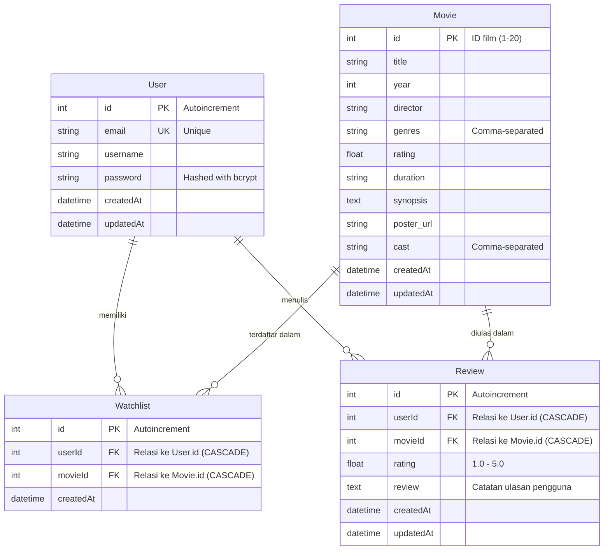

# 🎬 FilmLog — Movie Watchlist & Review RESTful API
> **GDGoC Back-End Recruitment Technical Assignment**  
> RESTful API pelacak film (*movie watchlist*) dan ulasan film terintegrasi autentikasi JWT serta **Google Gemini AI** yang di-grounding secara ketat pada database lokal.

---

## 📌 Daftar Isi
- [Daftar Isi](#-daftar-isi)
- [✨ Fitur Utama](#-fitur-utama)
- [🛠️ Tech Stack \& Arsitektur](#️-tech-stack--arsitektur)
- [🗄️ Database Architecture \& ERD](#️-database-architecture--erd)
- [📁 Struktur Proyek](#-struktur-proyek)
- [⚙️ Prasyarat \& Variabel Lingkungan (.env)](#️-prasyarat--variabel-lingkungan-env)
- [🚀 Panduan Menjalankan Aplikasi](#-panduan-menjalankan-aplikasi)
- [📑 Dokumentasi Endpoint API (API Contract)](#-dokumentasi-endpoint-api-api-contract)
- [🤖 Strategi Gemini AI Prompt Grounding](#-strategi-gemini-ai-prompt-grounding)
- [🔒 Keamanan \& Error Handling Semantik](#-keamanan--error-handling-semantik)
- [🧪 Pengujian Otomatis (Automated Testing)](#-pengujian-otomatis-automated-testing)
- [💻 Menguji dengan Frontend Companion](#-menguji-dengan-frontend-companion)
- [📦 Tautan Pengumpulan (Deliverables)](#-tautan-pengumpulan-deliverables)

---

## ✨ Fitur Utama
1. **🔐 Autentikasi & Otorisasi Pengguna:** Registrasi dan login dengan enkripsi kata sandi menggunakan `bcryptjs` dan proteksi endpoint privat menggunakan `JSON Web Token (JWT)`.
2. **🎬 Katalog Film Terkurasi:** Menampilkan 20 film kurasi awal dengan fitur pencarian judul/sutradara, filter genre dinamis, dan pengacakan (*shuffle*).
3. **📌 Manajemen Watchlist Privat:** Menambahkan, melihat, dan menghapus film tontonan pribadi dengan pencegahan duplikasi data (*Unique Constraint* & HTTP `409 Conflict`).
4. **⭐ Catatan Tontonan & Review:** Mencatat riwayat film yang telah ditonton beserta rating 1–5 bintang dan opini pengguna.
5. **🧠 Rekomendasi Cerdas Google Gemini AI (Local Grounding):** Menganalisis preferensi/suasana hati (*mood*) pengguna dan memilihkan film yang **pasti ada di dalam 20 database lokal** beserta alasan kurasi dalam format JSON terstruktur.
6. **🛡️ Penanganan Error Semantik & Validasi Input:** Validasi data masuk dengan `Zod` dan format error terpusat (`400`, `401`, `404`, `409`, `500`).

---

## 🛠️ Tech Stack & Arsitektur
- **Runtime:** Node.js (v20+ / v22+)
- **Framework:** Express.js (Modern ES Modules)
- **Database:** SQLite (Lokal, cepat, dan mandiri tanpa konfigurasi server DB eksternal)
- **ORM:** Prisma ORM v6 (Type-safe client, migrasi otomatis, dan seeder)
- **AI SDK:** `@google/genai` (Google GenAI Official SDK dengan model `gemini-3.5-flash-lite` / `gemini-3.8-flash`)
- **Keamanan:** `bcryptjs` (Hashing password), `jsonwebtoken` (JWT Bearer Token), `cors`
- **Validasi:** `zod`

---

## 🗄️ Database Architecture & ERD

Sistem dimodelkan dalam 4 entitas relasional utama yang saling terhubung dengan integritas data referensial (*foreign key* dan *cascade delete*):



> **Aturan Integritas Data:**
> - Kolom `Watchlist` memiliki aturan unik ganda `@@unique([userId, movieId])` untuk menjamin seorang user tidak dapat menambahkan film yang sama dua kali ke watchlist.
> - Penghapusan data induk (`User` atau `Movie`) akan memicu `onDelete: Cascade` pada data anak (`Watchlist` dan `Review`).

---

## 📁 Struktur Proyek

```text
filmlog-backend/
├── data/                                 # Data kurasi film awal dari panitia
│   ├── movies.json                       # 20 data film awal (JSON)
│   └── seed.sql                          # Skrip SQL mentah
├── frontend/                             # Letterboxd-style SPA Frontend companion
│   ├── index.html
│   ├── app.js
│   └── README.md
├── prisma/
│   ├── schema.prisma                     # Definisi skema ERD Prisma
│   ├── seed.js                           # Script migrasi & seeder 20 film
│   └── dev.db                            # SQLite database lokal (diabaikan oleh git)
├── scripts/
│   └── test-endpoints.js                 # Automated end-to-end integration test
├── src/
│   ├── config/
│   │   ├── env.js                        # Environment variables loader
│   │   └── prisma.js                     # Prisma client singleton
│   ├── controllers/
│   │   ├── authController.js             # Handler registrasi & login user
│   │   ├── movieController.js            # Handler katalog film & detail
│   │   ├── watchlistController.js        # Handler CRUD watchlist
│   │   ├── watchedController.js          # Handler review & rating tontonan
│   │   └── aiController.js               # Handler rekomendasi Gemini AI
│   ├── middlewares/
│   │   ├── auth.js                       # Middleware otorisasi Bearer JWT
│   │   └── errorHandler.js               # Error handler terpusat & HTTP semantic status
│   ├── routes/
│   │   ├── authRoutes.js
│   │   ├── movieRoutes.js
│   │   ├── watchlistRoutes.js
│   │   └── watchedRoutes.js
│   ├── services/
│   │   └── geminiService.js              # Prompt engineering & grounding logic Gemini
│   ├── app.js                            # Inisialisasi Express, CORS, & routing
│   └── server.js                         # Server listener port 8000
├── .env.example                          # Template konfigurasi environment
├── FilmLog_API.postman_collection.json   # Export koleksi Postman siap pakai
├── package.json
└── README.md
```

---

## ⚙️ Prasyarat & Variabel Lingkungan (.env)

Pastikan lingkungan lokal Anda telah terpasang:
- **Node.js** (Minimal versi 20.x, direkomendasikan versi 22.x)
- **npm** (Versi 10.x atau lebih baru)

Salin file `.env.example` menjadi `.env`:
```bash
cp .env.example .env
```

Sesuaikan konfigurasi pada file `.env`:
```env
PORT=8000
DATABASE_URL="file:./dev.db"
JWT_SECRET="gdgoc_filmlog_super_secret_jwt_key_2026"
JWT_EXPIRES_IN="7d"
GEMINI_API_KEY="AIzaSy..." # Dapatkan secara gratis di https://aistudio.google.com
```

---

## 🚀 Panduan Menjalankan Aplikasi

### 1. Instalasi Dependensi
```bash
npm install
```

### 2. Setup Database & Seeding (20 Film Awal)
Perintah ini akan membuat database SQLite `prisma/dev.db` dan mengimpor 20 film dari `data/movies.json`:
```bash
npm run db:setup
```

*(Atau jika database sudah ada dan ingin me-reset seeder film saja)*:
```bash
npm run db:seed
```

### 3. Menjalankan Server Backend
Jalankan server dalam mode pengembangan (*auto-reload*):
```bash
npm run dev
```
Server akan aktif di: **`http://localhost:8000`** (Base API: `http://localhost:8000/api`).

---

## 📑 Dokumentasi Endpoint API (API Contract)

Semua endpoint API memiliki awalan `/api`.

### 1. Autentikasi (`/api/auth`)

#### `POST /api/auth/register`
Mendaftarkan pengguna baru dengan enkripsi password.
- **Request Body:**
  ```json
  {
    "username": "wawaDyah",
    "email": "wawa@example.com",
    "password": "password123"
  }
  ```
- **Response Success (201 Created):**
  ```json
  {
    "message": "Registrasi berhasil.",
    "user": {
      "id": 1,
      "email": "wawa@example.com",
      "username": "wawaDyah",
      "createdAt": "2026-11-06T00:00:00.000Z"
    }
  }
  ```
- **Response Error:** `400 Bad Request` (validasi Zod gagal), `409 Conflict` (email sudah terdaftar).

#### `POST /api/auth/login`
Mengautentikasi pengguna dan menerbitkan JSON Web Token.
- **Request Body:**
  ```json
  {
    "email": "wawa@example.com",
    "password": "password123"
  }
  ```
- **Response Success (200 OK):**
  ```json
  {
    "token": "eyJhbGciOiJIUzI1NiIsInR5cCI6IkpXVCJ9...",
    "user": {
      "id": 1,
      "email": "wawa@example.com",
      "username": "wawaDyah"
    }
  }
  ```
- **Response Error:** `401 Unauthorized` (kredensial salah).

---

### 2. Movies Catalog (`/api/movies`)

#### `GET /api/movies`
Mengambil daftar katalog film dengan dukungan filter pencarian, genre, dan acak urutan.
- **Query Params (Opsional):**
  - `genre`: Filter berdasarkan genre (contoh: `?genre=Sci-Fi`)
  - `search`: Pencarian teks pada judul atau sutradara (contoh: `?search=Nolan`)
  - `shuffle`: Acak urutan film (contoh: `?shuffle=true`)
- **Response Success (200 OK):**
  ```json
  [
    {
      "id": 1,
      "title": "Inception",
      "year": 2010,
      "director": "Christopher Nolan",
      "genres": ["Sci-Fi", "Action", "Thriller"],
      "rating": 8.8,
      "duration": "148 min",
      "synopsis": "Seorang pencuri ulung yang mengekstrak rahasia perusahaan...",
      "poster_url": "https://image.tmdb.org/t/p/w500/oYuLEt3zVCKq57qu2F8dT7NIa6f.jpg",
      "cast": ["Leonardo DiCaprio", "Joseph Gordon-Levitt", "Elliot Page", "Tom Hardy"]
    }
  ]
  ```

#### `GET /api/movies/:id`
Mengambil informasi lengkap satu film berdasarkan ID.
- **Response Success (200 OK):** Data detail film.
- **Response Error:** `400 Bad Request` (ID bukan angka), `404 Not Found` (Film tidak ada).

---

### 3. Watchlist (`/api/watchlist`) — *Protected Route*
> **Header Wajib:** `Authorization: Bearer <token_jwt>`

#### `GET /api/watchlist`
Melihat daftar film yang disimpan dalam watchlist pengguna yang sedang login.
- **Response Success (200 OK):** Array objek film watchlist.

#### `POST /api/watchlist`
Menambahkan film ke dalam watchlist pengguna.
- **Request Body:** `{ "movieId": 1 }`
- **Response Success (201 Created):**
  ```json
  {
    "message": "Film berhasil ditambahkan ke watchlist.",
    "data": {
      "id": 1,
      "movieId": 1,
      "movie": { "id": 1, "title": "Inception", ... }
    }
  }
  ```
- **Response Error:** 
  - `404 Not Found` jika `movieId` tidak ada di database film.
  - `409 Conflict` jika film sudah pernah dimasukkan ke watchlist pengguna tersebut.

#### `DELETE /api/watchlist/:movieId`
Menghapus film dari watchlist pengguna.
- **Response Success (200 OK):** `{ "message": "Film berhasil dihapus dari watchlist." }`
- **Response Error:** `404 Not Found` jika film tidak ada di dalam watchlist pengguna.

---

### 4. Watched & Reviews (`/api/watched`) — *Protected Route*
> **Header Wajib:** `Authorization: Bearer <token_jwt>`

#### `GET /api/watched`
Mengambil seluruh riwayat tontonan dan ulasan dari pengguna yang sedang login.
- **Response Success (200 OK):** Array riwayat tontonan dengan rating dan review.

#### `POST /api/watched`
Mencatat film yang sudah ditonton beserta rating bintang (1–5) dan ulasan opini.
- **Request Body:**
  ```json
  {
    "movieId": 1,
    "rating": 5,
    "review": "Film yang sangat luar biasa dengan alur cerita berlapis!"
  }
  ```
- **Response Success (201 Created):** Objek catatan review yang berhasil disimpan.
- **Response Error:** `400 Bad Request` (rating di luar skala 1–5 atau review kosong), `404 Not Found` (movie tidak ada).

---

### 5. Gemini AI Movie Recommendation (`/api/movies/recommend`)

#### `POST /api/movies/recommend`
Meminta rekomendasi film berdasarkan deskripsi, suasana hati (*mood*), atau preferensi bebas dari pengguna.
- **Request Body:**
  ```json
  {
    "prompt": "Saya mau film misteri psikologis yang membingungkan pikiran dan penuh plot twist"
  }
  ```
- **Response Success (200 OK):**
  ```json
  {
    "movie_id": 14,
    "reasoning": "Film Memento sangat cocok untuk Anda karena menyajikan teka-teki psikologis yang unik dengan alur cerita non-linear yang bergerak mundur...",
    "movie": {
      "id": 14,
      "title": "Memento",
      "year": 2000,
      "director": "Christopher Nolan",
      "genres": ["Mystery", "Thriller"],
      "rating": 8.4,
      ...
    }
  }
  ```

---

## 🤖 Strategi Gemini AI Prompt Grounding

Salah satu penilaian utama penugasan (**Bobot 20%**) adalah memastikan rekomendasi LLM **tidak berhalusinasi** dan **hanya merekomendasikan film yang benar-benar ada di database lokal**:

1. **Injeksi Data Dinamis:** Sebelum prompt dikirimkan ke model Gemini, backend mengekstrak ringkasan ke-20 film lokal (`id`, `title`, `year`, `genres`, `director`, `rating`, `synopsis`) langsung dari database SQLite.
2. **Strict System Instruction:**
   - Model diinstruksikan bertindak sebagai kurator film profesional untuk FilmLog.
   - Diberikan *hard constraint* bahwa rekomendasi **wajib dan hanya boleh** dipilih dari daftar kandidat yang disertakan dalam prompt.
   - Mengharuskan output dalam format **JSON murni** (`responseMimeType: 'application/json'`) dengan properti `movie_id` dan `reasoning`.
3. **Verifikasi Post-Generation:** Backend memverifikasi kembali apakah `movie_id` yang dihasilkan oleh Gemini benar-benar ada di dalam database sebelum mengembalikan respon ke klien.

---

## 🔒 Keamanan & Error Handling Semantik

- **Password Hashing:** Menggunakan `bcryptjs` dengan salt round 10, sehingga kata sandi asli pengguna tidak pernah tersimpan di database.
- **Otorisasi Token JWT:** Rute privat dijaga oleh middleware `authenticateToken` yang memvalidasi header `Authorization: Bearer <token>`.
- **Validasi Skema Zod:** Mencegah request body tidak valid (format email, panjang password, batas rating bintang 1–5).
- **Semantic HTTP Status Codes:**
  - `200 OK`: Permintaan berhasil diproses.
  - `201 Created`: Pembuatan entitas baru berhasil (register, add watchlist, log review).
  - `400 Bad Request`: Validasi input gagal atau format parameter salah.
  - `401 Unauthorized`: Token tidak ada, token kadaluarsa, atau kredensial login salah.
  - `404 Not Found`: Data film atau item tidak ditemukan.
  - `409 Conflict`: Terjadi duplikasi data (email sudah terdaftar atau film sudah ada di watchlist).
  - `500 Internal Server Error`: Kesalahan sistem yang ditangani secara terpusat tanpa membocorkan stack trace sensitif di mode produksi.

---

## 🧪 Pengujian Otomatis (Automated Testing)

Proyek ini telah dilengkapi dengan script pengujian integrasi otomatis menyeluruh (*end-to-end integration tests*) untuk memvalidasi seluruh alur bisnis dan autentikasi.

Jalankan pengujian:
```bash
npm test
```

**Hasil Pengujian:**
```text
🧪 Test server running on http://localhost:8001

1. Testing GET /api/movies... -> 200 OK (20 movies found)
2. Testing GET /api/movies/1... -> 200 OK ("Inception")
3. Testing POST /api/auth/register... -> 201 Created
4. Testing POST /api/auth/login... -> 200 OK (JWT Token received)
5. Testing POST /api/watchlist... -> 201 Created
6. Testing duplicate POST /api/watchlist... -> 409 Conflict (Handled!)
7. Testing GET /api/watchlist... -> 200 OK
8. Testing POST /api/watched... -> 201 Created (Rating & Review logged)
9. Testing GET /api/watched... -> 200 OK
10. Testing DELETE /api/watchlist/1... -> 200 OK
11. Testing POST /api/movies/recommend (Gemini Grounding)... -> 200 OK (Movie ID: 14)

🎉 ALL CORE REST ENDPOINTS + GEMINI AI TESTED AND WORKING PERFECTLY!
```

---

## 💻 Menguji dengan Frontend Companion

Backend ini dirancang kompatibel 100% dengan frontend companion bawaan di folder `frontend/`:

1. Pastikan backend aktif: `npm run dev`
2. Buka file `frontend/index.html` di browser Anda (atau gunakan VS Code Live Server).
3. Anda dapat langsung menguji seluruh fitur antarmuka: Discover katalog, Register/Login, tambah/hapus Watchlist, review film Watched, rekomendasi AI, serta memantau log jaringan di drawer **API Inspector**.

---

## 📦 Tautan Pengumpulan (Deliverables)

| Komponen | Tautan / Keterangan |
| :--- | :--- |
| **Repositori Kode Sumber** | [GitHub Repository](https://github.com/wawaDyah/filmlog-backend) *(Ganti sesuai URL repo Anda)* |
| **Video Walkthrough (3–5 Menit)** | [Google Drive Video Link](https://drive.google.com/...) *(Setel ke "Anyone with the link can view")* |
| **Live Deployment API (Bonus)** | *https://filmlog-api.onrender.com* *(Opsional/Bonus jika di-deploy)* |
| **Koleksi Postman** | [`FilmLog_API.postman_collection.json`](./FilmLog_API.postman_collection.json) |
