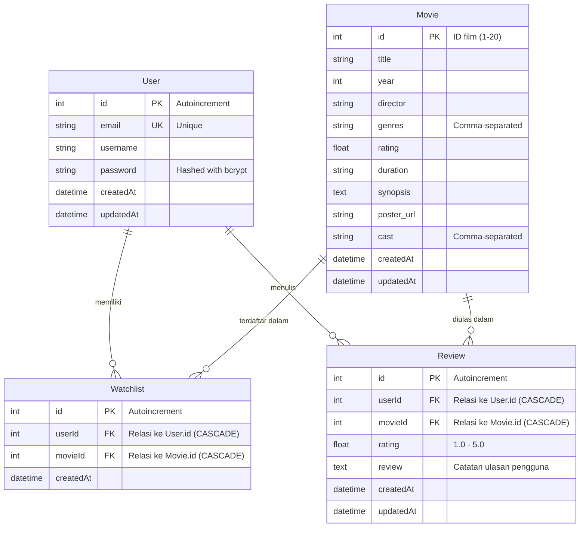

# FilmLog — Movie Watchlist & Review Platform (RESTful API & Web)

[](https://filmlog-backend.vercel.app)
[](https://nodejs.org)
[](https://expressjs.com)
[](https://www.prisma.io)
[](https://www.sqlite.org)
[](https://aistudio.google.com)

>  **Live Demo & API URL:** [https://filmlog-backend.vercel.app](https://filmlog-backend.vercel.app)

---

## 📖 Tentang Penugasan (Project Context)

Repositori ini dibangun sebagai pemenuhan **Technical Assignment Google Developer Groups on Campus (GDGoC) - Hacker Track (Back-End Developer)**.

Aplikasi **FilmLog** adalah platform pelacak dan peninjau film (*movie watchlist & review platform*) yang terinspirasi dari **Letterboxd** dan **IMDb**. Platform ini memungkinkan pengguna untuk:
1. **Discover:** Menjelajahi katalog 20 film kurasi awal dengan atribut sinematik lengkap (sutradara, sinopsis, cast, poster, rating).
2. **Auth:** Mendaftar akun baru dan login dengan otentikasi berbasis **JSON Web Token (JWT)** dan enkripsi kata sandi.
3. **Watchlist:** Mengelola daftar tontonan pribadi secara dinamis tanpa risiko data duplikat.
4. **Watched & Reviews:** Mencatat film yang telah ditonton dengan rating bintang (1–5) dan catatan opini/review.
5. **AI Recommendation:** Mendapatkan rekomendasi film yang dipersonalisasi menggunakan **Google Gemini LLM** yang secara ketat di-*grounding* hanya pada 20 film yang tersedia di database lokal.

Aplikasi ini bersifat **Full-Stack Ready**: server backend secara otomatis melayani antarmuka visual frontend bertema Letterboxd di halaman root (`/`) sekaligus menyediakan rute REST API lengkap di bawah path `/api/...`.

---

## Ringkasan Tech Stack & Alasan Pemilihan

| Layer | Teknologi | Peran & Alasan Pemilihan |
| :--- | :--- | :--- |
| **Runtime** | **Node.js (v22+)** | Runtime JavaScript modern dengan kinerja I/O asinkron yang tinggi dan ekosistem paket npm yang matang. Menggunakan format **ECMAScript Modules (ESM)** native. |
| **Framework** | **Express.js (v5)** | Framework backend minimalis, cepat, dan standar industri untuk membangun RESTful API yang bersih dan modular. |
| **Database** | **SQLite** | Basis data relasional berbasis file yang mandiri (*self-contained*), bebas konfigurasi server database terpisah, cepat untuk pengembangan lokal, dan mudah di-deploy. |
| **ORM** | **Prisma ORM (v6)** | ORM modern yang menyediakan *type-safe database client*, pengelolaan skema relasional (ERD) yang mudah dibaca, serta sistem migrasi dan seeder otomatis. |
| **Artificial Intelligence** | **Google Gemini API (`@google/genai`)** | Menggunakan model `gemini-3.5-flash-lite` / `gemini-3.8-flash` dengan teknik **In-Context Grounding** untuk menghasilkan rekomendasi film yang relevan, bebas halusinasi, dan berformat JSON terstruktur. |
| **Keamanan & Otorisasi** | **bcryptjs & jsonwebtoken** | Password diacak menggunakan *one-way cryptographic hash* (10 salt rounds) dan rute privat dijaga oleh middleware otentikasi *Bearer Token JWT*. |
| **Validasi Input** | **Zod** | Validasi skema request body yang ketat (panjang karakter, format email, batasan rating bintang 1–5) untuk menjamin integritas data sebelum menyentuh database. |
| **Frontend UI** | **Vanilla JS + Tailwind CSS CDN** | Antarmuka pengguna bergaya Letterboxd yang bersifat *zero-build* (tanpa perlu kompilasi npm tambahan), langsung disajikan oleh server Express. |

---

##  Panduan Menjalankan di Localhost (Local Setup Guide)

Bagi siapa pun (termasuk reviewer atau pengembang lain) yang ingin meng-clone dan menjalankan aplikasi ini secara lokal di komputer masing-masing, ikuti langkah mudah berikut:

### 1. Prasyarat Lingkungan
Pastikan komputer Anda sudah terpasang:
- **Node.js** versi 20.x atau 22.x ([Unduh Node.js](https://nodejs.org/))
- **Git** ([Unduh Git](https://git-scm.com/))

### 2. Clone Repositori
Buka terminal dan unduh repositori ini:
```bash
git clone https://github.com/wawadyah/filmlog-backend.git
cd filmlog-backend
```

### 3. Instalasi Dependensi
Instal semua pustaka yang diperlukan:
```bash
npm install
```
*(Proses ini juga akan otomatis memicu script `postinstall` untuk men-generate Prisma Client).*

### 4. Konfigurasi Variabel Lingkungan (.env)
Salin berkas template environment:
```bash
cp .env.example .env
```
Buka berkas `.env` di teks editor Anda. Isi dan sesuaikan variabelnya:
```env
PORT=8000
DATABASE_URL="file:./dev.db"
JWT_SECRET="gdgoc_filmlog_super_secret_jwt_key_2026"
JWT_EXPIRES_IN="7d"
GEMINI_API_KEY="MASUKKAN_GEMINI_API_KEY_ANDA_DISINI"
```
>  **Mendapatkan Gemini API Key:** Anda bisa mendapatkan API Key gratis dalam 1 menit di **[Google AI Studio](https://aistudio.google.com)**.

### 5. Setup Database & Seeding (20 Film Awal)
Jalankan perintah ini untuk menyinkronkan skema database SQLite dan mengimpor 20 film kurasi awal:
```bash
npm run db:setup
```

### 6. Jalankan Server Aplikasi
Jalankan server dalam mode pengembangan (*auto-reload* jika ada perubahan kode):
```bash
npm run dev
```

Server backend dan frontend visual sekarang aktif di:
 **`http://localhost:8000`**

Buka tautan di atas di browser Anda. Anda akan langsung melihat antarmuka web FilmLog siap pakai!

### 7. Menjalankan Pengujian Otomatis (Automated Tests)
Untuk memverifikasi bahwa seluruh endpoint API, autentikasi, database SQLite, dan koneksi Gemini AI berfungsi 100%:
```bash
npm test
```
*(Seluruh 11 skenario pengujian akan berjalan secara otomatis).*

---

## 🗄️ Database Architecture & ERD

Sistem dimodelkan dalam 4 entitas relasional utama yang saling terhubung dengan integritas data referensial:



> **Aturan Integritas Data:**
> - **Anti-Duplikasi Watchlist:** Kolom `Watchlist` memiliki aturan unik ganda `@@unique([userId, movieId])`. Seorang pengguna tidak dapat menambahkan film yang sama dua kali ke watchlist-nya (menghasilkan status HTTP `409 Conflict`).
> - **Cascade Deletion:** Menghapus data induk (`User` atau `Movie`) secara otomatis menghapus rekaman terkait di `Watchlist` dan `Review` via `onDelete: Cascade`.

---

## 📑 Dokumentasi Endpoint REST API (API Contract)

Semua rute API dapat diakses melalui awalan `/api`.

| Kategori | Method | Endpoint | Deskripsi | Akses |
| :--- | :---: | :--- | :--- | :---: |
| **Auth** | `POST` | `/api/auth/register` | Mendaftarkan user baru (password di-hash) | Publik |
| **Auth** | `POST` | `/api/auth/login` | Otentikasi user & mengembalikan Bearer Token JWT | Publik |
| **Movies** | `GET` | `/api/movies` | Katalog film (support `?genre=...`, `?search=...`, `?shuffle=true`) | Publik |
| **Movies** | `GET` | `/api/movies/:id` | Mengambil detail lengkap 1 film berdasarkan ID | Publik |
| **Watchlist** | `GET` | `/api/watchlist` | Mengambil daftar film watchlist user yang sedang login | Bearer Token |
| **Watchlist** | `POST` | `/api/watchlist` | Menambahkan film ke watchlist (`{ movieId: 1 }`) | Bearer Token |
| **Watchlist** | `DELETE`| `/api/watchlist/:movieId` | Menghapus film dari watchlist user | Bearer Token |
| **Watched** | `GET` | `/api/watched` | Riwayat tontonan dan ulasan dari user yang login | Bearer Token |
| **Watched** | `POST` | `/api/watched` | Log film yang ditonton (`{ movieId, rating, review }`) | Bearer Token |
| **AI** | `POST` | `/api/movies/recommend` | Rekomendasi film Gemini berbasis 20 film lokal | Publik |

---

## Strategi Gemini AI Prompt Grounding

Untuk menjamin model bahasa (LLM) **tidak berhalusinasi** dan **hanya merekomendasikan film yang benar-benar ada di database lokal**:
1. **Dynamic Data Retrieval:** Backend mengekstrak ringkasan 20 film lokal (`id`, `title`, `year`, `genres`, `director`, `rating`, `synopsis`) langsung dari SQLite.
2. **Hard Negative Constraint:** `systemInstruction` melarang keras Gemini merekomendasikan film di luar 20 kandidat lokal, apapun permintaan pengguna.
3. **Structured JSON Output:** Menggunakan `responseMimeType: 'application/json'` sehingga respon selalu berupa JSON valid berisi `movie_id` dan `reasoning`.
4. **Server-Side Validation:** Backend memverifikasi ulang bahwa `movie_id` hasil pilihan Gemini benar-benar ada di tabel lokal sebelum mengembalikan respon ke pengguna.

---

## Keamanan & Penanganan Error Semantik

Sistem mengembalikan kode status HTTP semantik standar RESTful API:
- `200 OK`: Permintaan berhasil diproses.
- `201 Created`: Pembuatan entitas baru berhasil (register, watchlist, review).
- `400 Bad Request`: Validasi skema Zod gagal, format email tidak valid, atau ID film bukan angka.
- `401 Unauthorized`: Token JWT tidak disertakan, format tidak valid, token kadaluarsa, atau password salah.
- `404 Not Found`: Film atau item yang dicari tidak ada di database.
- `409 Conflict`: Terjadi duplikasi data (email sudah terdaftar atau film sudah ada di watchlist).
- `500 Internal Server Error`: Kesalahan internal server yang ditangani secara terpusat tanpa membocorkan stack trace sensitif di mode produksi.

---

## 📁 Struktur Repositori

```text
filmlog-backend/
├── data/                                 # Dataset kurasi awal (20 film)
│   ├── movies.json
│   └── seed.sql
├── frontend/                             # Letterboxd-style SPA Frontend companion
│   ├── index.html
│   ├── app.js
│   └── README.md
├── prisma/
│   ├── schema.prisma                     # Skema relasional database Prisma
│   ├── seed.js                           # Script migrasi & seeder 20 film
│   └── dev.db                            # SQLite database lokal
├── scripts/
│   └── test-endpoints.js                 # Automated end-to-end integration test
├── src/
│   ├── config/                           # Environment & Prisma client configuration
│   ├── controllers/                      # Handler logika request & response
│   ├── middlewares/                      # Auth JWT guard & centralized error handler
│   ├── routes/                           # Deklarasi router Express
│   ├── services/                         # Integrasi Gemini AI Prompt Grounding
│   ├── app.js                            # Inisialisasi Express & routing static frontend
│   └── server.js                         # Server listener port 8000
├── api/
│   └── index.js                          # Serverless Function entrypoint untuk Vercel
├── .env.example                          # Template konfigurasi environment
├── FilmLog_API.postman_collection.json   # Export koleksi Postman siap impor
├── vercel.json                           # Konfigurasi deployment Vercel
├── package.json
└── README.md
```

---

## Tautan Pengumpulan (Deliverables)

| Komponen | Tautan / Berkas |
| :--- | :--- |
| **Repositori Kode Sumber** | [https://github.com/wawadyah/filmlog-backend](https://github.com/wawadyah/filmlog-backend) |
| **Live Deployment URL** | [https://filmlog-backend.vercel.app](https://filmlog-backend.vercel.app) |
| **Video Walkthrough (3–5 Menit)** | [Google Drive Video Link](https://drive.google.com/) *(Setel ke "Anyone with the link can view")* |
| **Koleksi Postman** | [`FilmLog_API.postman_collection.json`](./FilmLog_API.postman_collection.json) |
| **Panduan Naskah Video** | [`WALKTHROUGH_CHEATSHEET.md`](./WALKTHROUGH_CHEATSHEET.md) |
